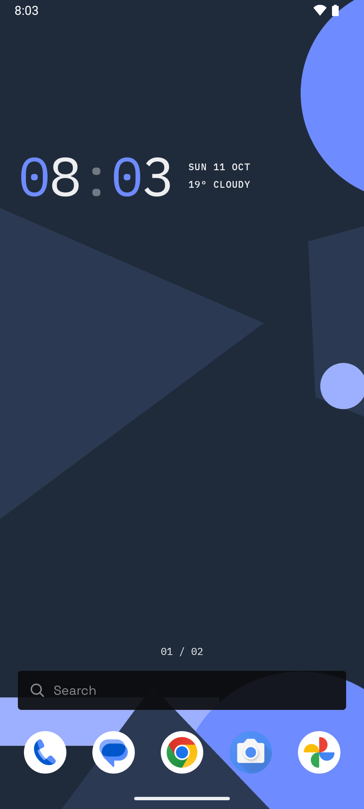
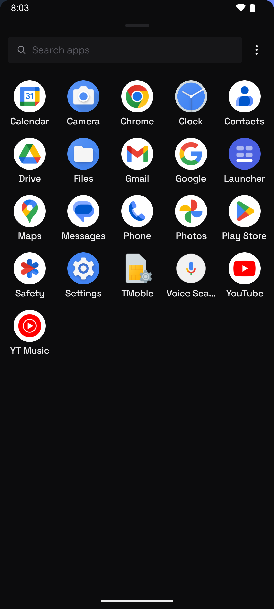
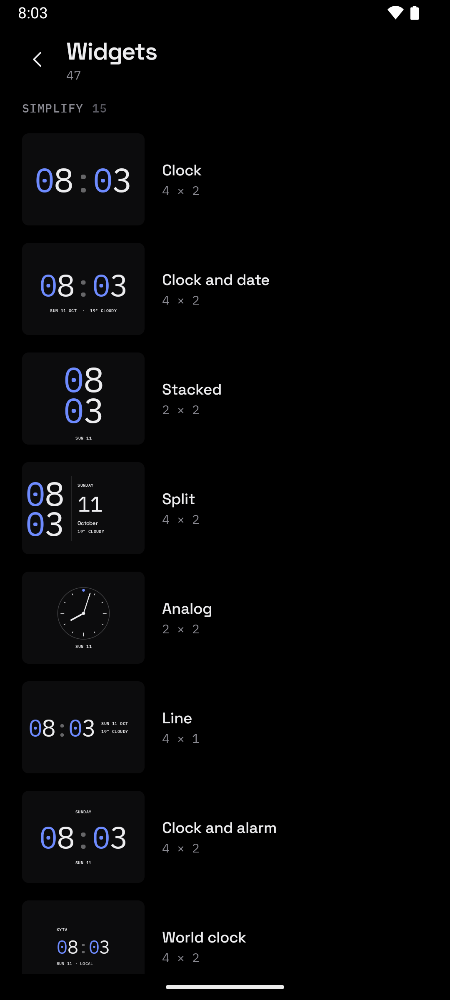
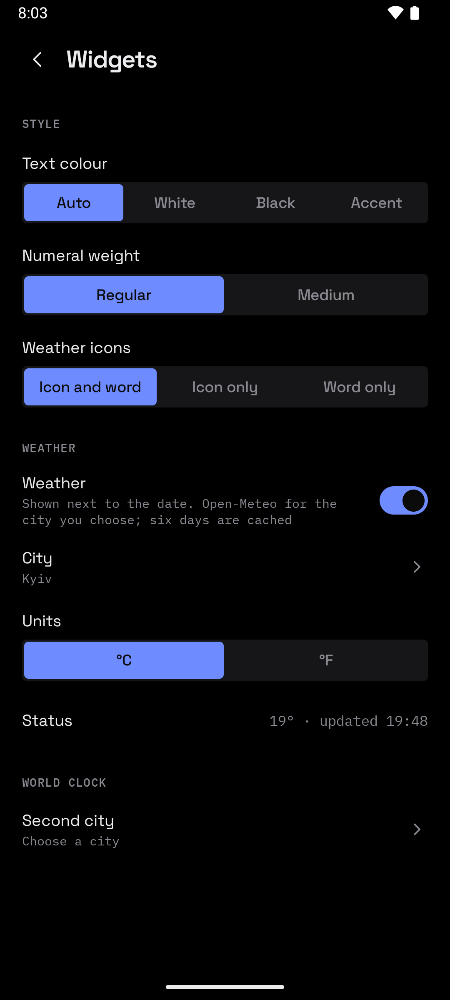

<p align="center">
  
</p>
<p align="center">
  <b>A home screen that stays out of the way.</b><br>
  Free. No ads, no account, no tracking, nothing leaves the phone.
</p>

<p align="center">
  <a href="https://simplifymy.app/apps/launcher/">Website</a> ·
  <a href="https://github.com/simplifymy-app/launcher/releases">Changelog</a>
</p>

<p align="center">
  
  
  
</p>

Pages, a dock, folders and an app drawer, with all the settings a launcher should have — and a clock that reads well on your wallpaper. The clock, date and weather widgets are drawn by the launcher itself in the same mono type as the other Simplify apps, every zero in your accent colour, and the text turns light or dark to suit the wallpaper.

## ✦ What it does

| | |
| --- | --- |
| **Home** | Pages, grid size, dock, page indicator. Drag icons and widgets wherever you want them |
| **Drawer** | A sheet from the bottom or top, or its own page of the home screen. Tabs, hidden apps, a letter scroller |
| **Search** | Apps, app shortcuts, contacts and maths, from the bar on every page |
| **Folders** | A small window above the icon or a full page, your choice |
| **Widgets** | Fifteen built-in: clocks, world clock, weather, forecast, date, battery. Every system widget too, resizable in place |
| **Gestures** | Swipe, pinch and double-tap, each mapped to any action |
| **Icons** | Icon packs, icon shapes, notification dots or counts |
| **Make it yours** | Light, dark or pure black, five accents, English and Ukrainian, all switching live |
| **Keep** | The whole layout and every setting backed up to one file |

Weather is off until you pick a city by name: no location permission, no key, six days of forecast kept on the phone. It is the only thing that ever touches the network.



## 📦 Install

Not released yet — the build runs and the polish is next. Android 11 or newer.

## 🔨 Build

You need JDK 17+ and the Android SDK. Use the Makefile, not raw gradle.

```
make run        # install the debug build, make it the default home app, go home
make settings   # open the launcher settings
make apk        # minified release APK into dist/
make bundle     # signed release AAB into dist/, for Google Play
make emulator   # boot an AVD
make logcat     # follow the app log
make lint       # android lint over the debug variant
```

`make help` lists the rest. JVM tests run with `./gradlew :app:testDebugUnitTest`; the end-to-end suite lives in `app/src/androidTest`.

Release builds are signed with the Play upload key from `keystore.properties`, which is not in the repository. Without it they fall back to the debug keystore, so a fresh clone still builds an installable APK.

## 🧭 Layout

```
core/apps        LauncherApps across every profile, app shortcuts
core/icons       icon packs, shape masking, cache
core/workspace   Room: desktop, dock, folders, app overrides, drawer groups
core/settings    one serializable Settings document in DataStore
core/actions     gesture actions and the accessibility service behind them
core/weather     Open-Meteo forecast and its offline cache
core/backup      JSON export and import of settings and layout
ui/theme         Simplify tokens, shared with the other apps
feature/home     home screen, drag and drop, folders, widgets, overview
feature/drawer   app drawer and search
feature/settings every settings page
```

Kotlin and Jetpack Compose in a single `:app` module, manual dependency injection, no Hilt. Strings are generated for English and Ukrainian from one table, so both languages always have the same keys.
