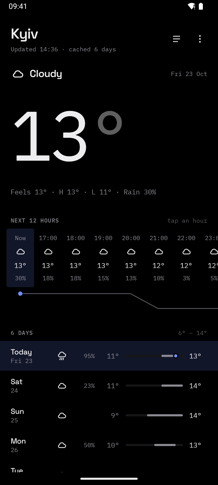

<p align="center">
  
</p>
<p align="center">
  <b>A home screen that stays out of the way.</b><br>
  Free. No ads, no account, no tracking, nothing leaves the phone.
</p>

<p align="center">
  <a href="https://simplifymy.app/apps/launcher/">Website</a> ·
  <a href="https://github.com/simplifymy-app/launcher/releases">Changelog</a>
</p>

> [!WARNING]
> **Experimental.** This launcher is an early, experimental project. It is provided as is, without warranty of any kind, and may lose data, break or change at any time. If you use it, you do so entirely at your own risk. See [LICENSE](LICENSE).

<p align="center">
  
  
  
</p>

Pages, a dock, folders and an app drawer, with all the settings a launcher should have — and a clock that reads well on your wallpaper. The clock, date and weather widgets are drawn by the launcher itself in the same mono type as the other Simplify apps, every zero in your accent colour, and the text turns light or dark to suit the wallpaper.

## ✦ What it does

| | |
| --- | --- |
| **Home** | Pages, grid size, dock, page indicator. Drag icons and widgets wherever you want them |
| **Drawer** | A sheet from the bottom or top, or its own page of the home screen. Tabs, hidden apps, a letter scroller |
| **Search** | Apps, app shortcuts, contacts and maths, from the bar on every page |
| **Folders** | A small window above the icon or a full page, your choice |
| **Widgets** | Twenty-one built-in: clocks, world clock, calendar, weather, next hours, forecast, date, battery. Every system widget too, resizable in place |
| **Calendar** | Agenda, clock and calendar, today, next event and a month grid, with a day sheet and the forecast beside your plans |
| **Weather** | Today with the next 12 hours and six days, every day in three-hour steps, up to ten cities. Its own icon in your app list |
| **Gestures** | Swipe, pinch and double-tap, each mapped to any action |
| **Icons** | Icon packs, icon shapes, notification dots or counts |
| **Make it yours** | Light, dark or pure black, five accents, English and Ukrainian, all switching live |
| **Keep** | The whole layout and every setting backed up to one file |

Weather is off until you pick a city by name: no location permission, no key, no account, six days of forecast kept on the phone for every city. It is the only thing that ever touches the network: the name you type goes out to look a city up, and the coordinates of the cities you keep to fetch their forecast.

Calendar widgets ask for calendar access only when you place one, and only read: they never add or change events, and nothing from your calendars leaves the phone.



## 📦 Install

Experimental builds are on the [Releases](https://github.com/simplifymy-app/launcher/releases) page — use them at your own risk. Android 11 or newer.

## 🔨 Build

You need JDK 17+ and the Android SDK. Use the Makefile, not raw gradle.

```
make run        # install the debug build, make it the default home app, go home
make settings   # open the launcher settings
make apk        # minified release APK into dist/
make bundle     # signed release AAB into dist/, for Google Play
make emulator   # boot an AVD
make logcat     # follow the app log
make lint       # android lint over the debug variant
```

`make help` lists the rest. JVM tests run with `./gradlew :app:testDebugUnitTest`; the end-to-end suite lives in `app/src/androidTest`.

Release builds are signed with the Play upload key from `keystore.properties`, which is not in the repository. Without it they fall back to the debug keystore, so a fresh clone still builds an installable APK.

## 🧭 Layout

```
core/apps        LauncherApps across every profile, app shortcuts
core/icons       icon packs, shape masking, cache
core/workspace   Room: desktop, dock, folders, app overrides, drawer groups
core/settings    one serializable Settings document in DataStore
core/actions     gesture actions and the accessibility service behind them
core/calendar    read-only events from the phone's calendars, month grid, agenda
core/weather     Open-Meteo forecast and geocoding, one offline cache per city
core/backup      JSON export and import of settings and layout
ui/theme         Simplify tokens, shared with the other apps
feature/home     home screen, drag and drop, folders, widgets, overview
feature/drawer   app drawer and search
feature/settings every settings page
feature/weather  Today, a day in three-hour steps, cities, adding a city
feature/calendar agenda sheet and the calendar access explainer
```

Kotlin and Jetpack Compose in a single `:app` module, manual dependency injection, no Hilt. Strings are generated for English and Ukrainian from one table, so both languages always have the same keys.

## 📄 License

© 2026 Simplify my app. The source code is licensed under the [Mozilla Public License 2.0](LICENSE): you may use, change and ship it, also in closed or commercial apps, but changes to these files must stay under the MPL and be shared. It is provided as is, without warranty of any kind.

Weather data comes from [Open-Meteo](https://open-meteo.com/) under [CC BY 4.0](https://creativecommons.org/licenses/by/4.0/), credited on the weather screen. The bundled fonts — Space Grotesk, Outfit, IBM Plex Sans and IBM Plex Mono — are under the SIL Open Font License 1.1.
